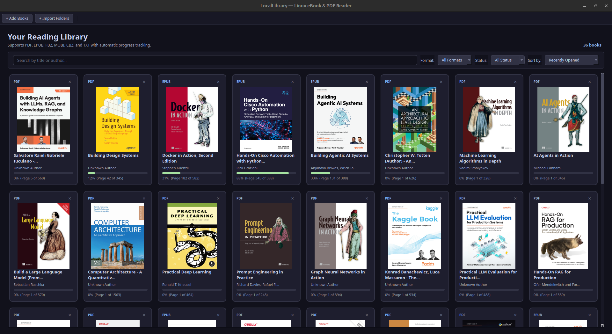
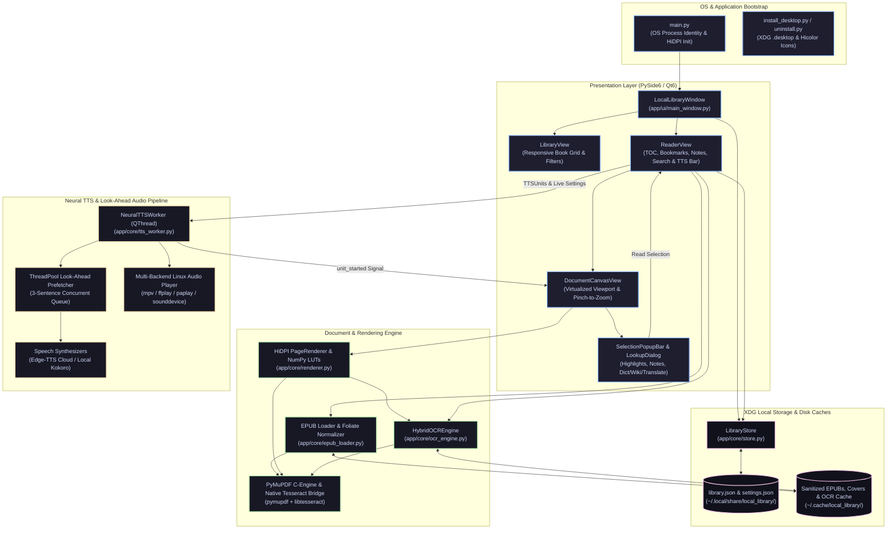
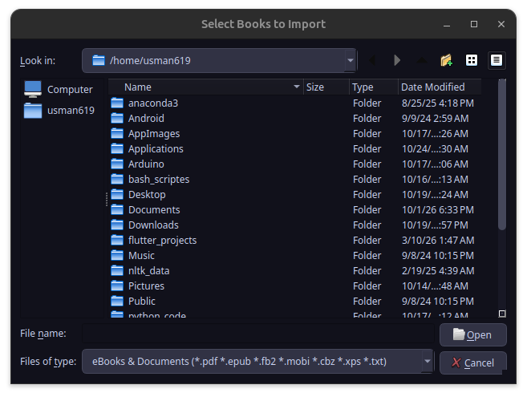
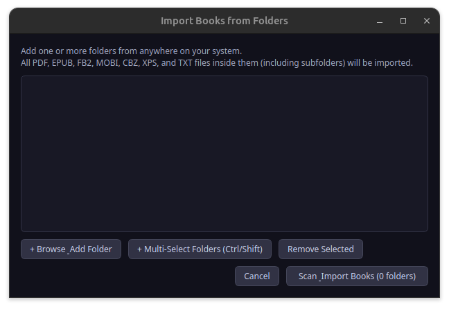
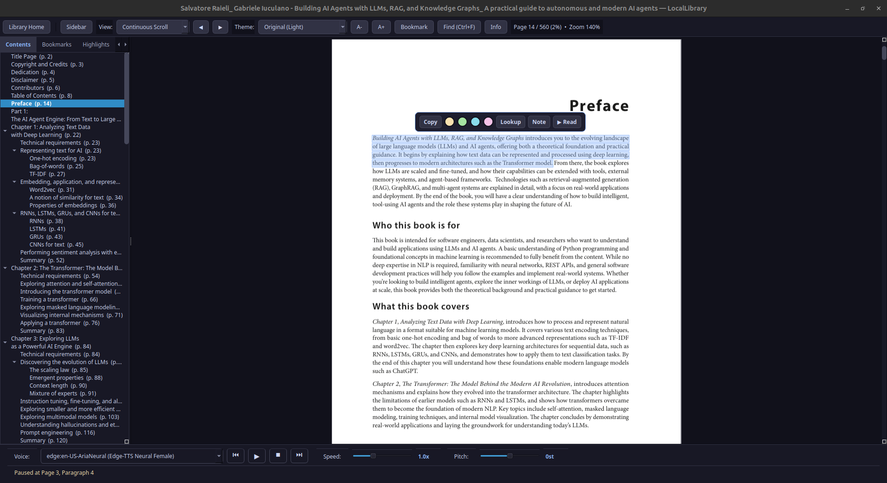
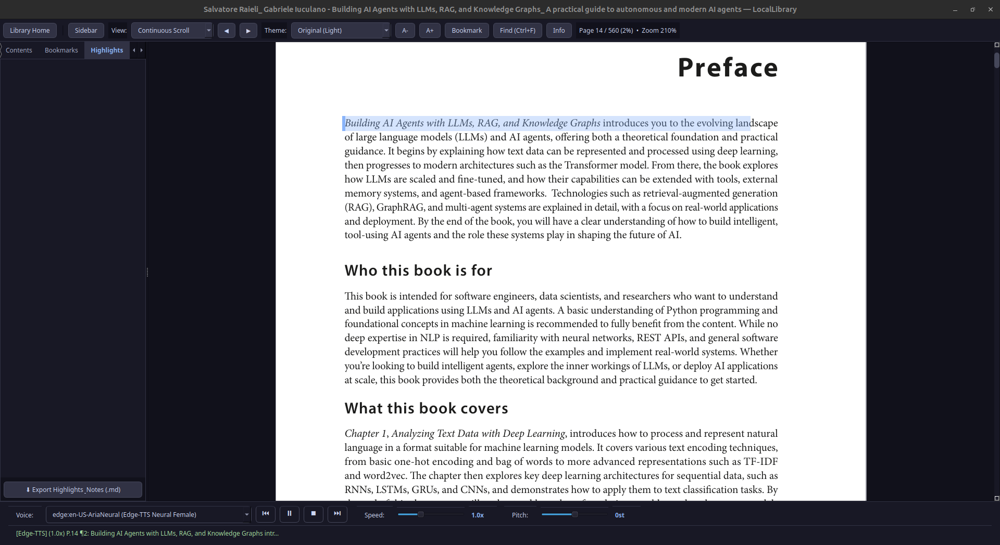
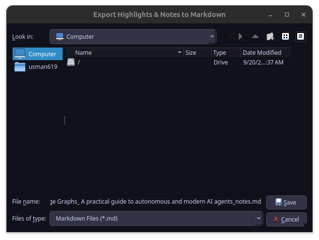

# LocalLibrary

<p align="center">
  
</p>

---

## About the Project

**LocalLibrary** is a high-performance, modern local library manager and document reader built natively for Linux using Python, **PySide6 (Qt6)**, and **PyMuPDF**. Inspired by modern reading tools like Foliate and Evince, LocalLibrary prioritizes a responsive, clean dark-themed UI, smooth high-performance rendering for heavy EPUB and PDF documents, multi-color annotations, Markdown exports, and local/cloud neural text-to-speech (TTS) integration.



---

## Key Features

* **Responsive Library Homepage:** Auto-reflowing responsive book grid with real-time window resizing, live search filtering by title/author, format filters, and completion status sorting.
* **Virtualized Document Canvas:** Renders multi-hundred page documents effortlessly, bypassing standard widget height limits to completely eliminate page-overlapping bugs at high zoom levels.
* **Trackpad Pinch-to-Zoom & View Modes:** Smooth 60 FPS cursor-anchored trackpad pinch-to-zoom (up to 250%) and `Ctrl + Scroll`, with support for Continuous Scroll, Single Page, and Two-Column Spread view modes.
* **Evince-Style Mouse Selection & Multi-Color Highlights:** Smooth reading-order word selection with a floating action popover and right-click context menu supporting Yellow, Green, Blue, and Pink highlight swatches.
* **Annotation Notes & Markdown Export:** Attach custom Markdown study notes to any highlight, track visual note indicators on the page and sidebar, and export all your notes and annotations to a clean `.md` file.
* **In-Book Search (`Ctrl+F`):** Slide-open search bar with live match counters, instant keyboard navigation (`Enter` / `Shift+Enter`), orange highlight overlays, and sidebar snippet previews.
* **Foliate-Style Popup Lookup:** One-click dictionary definitions, Wikipedia encyclopedic summaries, and multi-language neural translation.
* **TOC Scroll Tracking:** Automatically highlights, bolds, and scrolls to the active chapter in the Contents tree sidebar as you scroll through the book.
* **GPU-Accelerated Neural TTS:** Background daemon supporting Edge-TTS and Kokoro local models, complete with transport controls (`⏮`, `▶`/`⏸`, `⏹`, `⏭`), live speed/pitch sliders, and selection-based speech starting from exact sentences.
* **Reading Statistics & Metadata Inspector:** Live session tracker logging reading time, word count, completion percentage, and estimated time remaining.

---

## Prerequisites and Tech Stack

To run LocalLibrary on your Linux system, ensure you have the following installed:

* **Python 3.10+**
* **PySide6** (Qt6 UI Framework)
* **PyMuPDF** (`pymupdf` for high-speed PDF/EPUB rendering and text extraction)
* **NumPy** (for color lookup table image filters)
* *(Optional)* `edge-tts` or local audio backends for Neural Text-to-Speech.

### Installation and Environment Setup

```bash
# Clone the repository
git clone https://github.com/usman619/Local_Library.git
cd local_library

# Create and activate a virtual environment (or conda env)
python -m venv venv
source venv/bin/activate

# Install dependencies
pip install PySide6 pymupdf numpy edge-tts

# Install requirements
pip install -r requirements.txt
```

## System Architecture



## UI 
| **Feature**                    | **Screenshot Preview** |
|-------------------------------|------------------------|
| **Library Homepage**          |     |
| **Batch Add Books**           |     |
| **Multi-Folder Import**       |     |
| **Reader View & Spreads**     |     |
| **Selection Popover & Lookup**|     |
| **Neural TTS Bar**            |     |
| **Markdown Notes Export**     |     |
## Running the Application

To start LocalLibrary from source:

```bash
python main.py
```

To install LocalLibrary into your Linux application launcher menu with the custom app icon:

```bash
python install_desktop.py
```
To uninstall LocalLibrary from your linux application launcher menu:
```bash
python uninstall_desktop.py
```
## License
Distributed under the GPLv3 License. See [LICENSE](LICENSE) for more information.